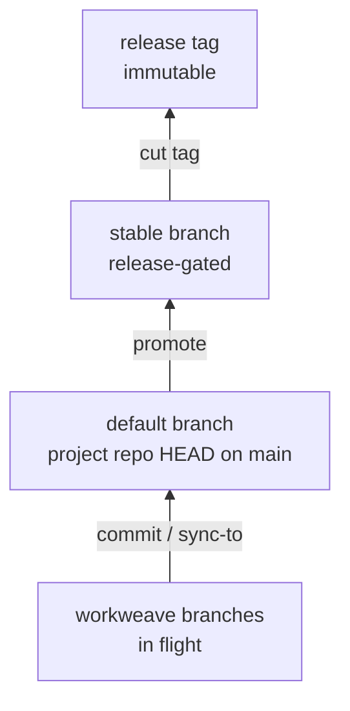

# Pyramid of stability

A cross-repo project does not have a single "tip." Each member repo
moves on its own schedule. The audience for a project — collaborators on
other machines, CI, agents starting from cold — needs a way to ask the
question every single-repo developer takes for granted: *what is the
current state?*

This joint defines what "stable" means for a repoweave project and how
the tool surfaces that stability.

## The problem the metaphor names

In a single-repo project, `HEAD` is the answer. `git fetch && git checkout
main` reproduces "what everyone is working from." There is one moving
part.

In a multi-repo project, the equivalent question — *what set of
revisions, across every member repo, should I be looking at right
now?* — does not have a built-in answer. Each repo's `main` advances
independently. Picking "each repo's latest `main`" gives you a set of
revisions no one has ever tested together. Picking "each repo at the
last release tag" overconstrains: most ongoing work happens against
revisions that no one has cut a release of yet.

The project needs its own notion of *canonical tip* — a recorded set of
per-repo revisions that "what is the current state" resolves to. The
recording is the project's job, not any individual repo's.

## Pyramid, not flat list

Real projects have multiple canonical tips, not one. A working metaphor:



Each tier is a *channel* — a place a collaborator might point `rwv
fetch` at. Each channel has its own cadence:

- **Workweave branches** advance on every cross-repo edit. Member
  repos move freely.
- **Default branch** of the project repo advances when a workweave's
  cross-repo work lands. Each landing is one project-repo commit that
  re-pins the member-repo SHAs.
- **Stable branch** advances when the maintainer promotes the default
  branch (typically after release-gating runs). It moves rarely; its
  consumers want minimum churn.
- **Release tags** are immutable. Cutting one is a forward-only choice.

The pyramid is a discipline pattern, not a tool feature: nothing in rwv
forces this shape. The shape falls out naturally because every project
repo is a git repo, and every branch or tag in that git repo carries its
own `rwv.lock` ([lock-as-derived](./lock-as-derived.md)):

- The stable branch's `rwv.lock` points at revisions that survived release-gating; the default branch's lock follows ongoing work; a feature workweave's branch has a lock at whatever the workweave was last left at.
- Without `rwv.lock`, each tier would only name itself by branch name in the project repo, and two collaborators syncing yesterday and today could see different member-repo content. With `rwv.lock`, every tier pins exact 40-character commit SHAs across all member repos.

Collaborators switch an existing weave to a specific channel (or historical release tag) by checking out that ref in the project repo and running bare `rwv fetch` (`--detach-checkouts` when aligning to commits behind branch tips):

```bash
# Switch the project repo to the stable channel (or a release tag like v1.2.3)
git -C projects/web-app checkout stable
rwv fetch --detach-checkouts          # align member repos to that channel's rwv.lock
```

## What "stable" means at the project level

A repoweave project is "stable" when:

1. Every member repo on disk is at exactly the SHA recorded in
   `rwv.lock`.
2. The project repo itself is at a committed HEAD that includes that
   lock.

Condition (1) is what [`rwv doctor`](../../reference/cli.md) checks; the
[lock-as-derived](./lock-as-derived.md) joint explains how the lock
gets there.

Condition (2) means the cross-repo state is *citable*: a single
`projects/<name>/` SHA names the entire pyramid tier. `sha256sum
rwv.lock` is the multi-repo equivalent of `git rev-parse HEAD` for a
flat repo.

Stability is per-channel, not global. The default branch may be in flux
while the stable branch is quiet; both can be reproducibly checked out.
The pyramid metaphor names this without inventing new vocabulary: a
channel is a branch is a `rwv.lock` is a set of SHAs.

## Concept versus tool feature

Worth being explicit about which parts of this joint are mechanical and
which are pattern:

| Element | Concept or tool feature |
|---|---|
| Canonical tip (one set of recorded SHAs) | Tool feature — `rwv.lock` |
| `rwv fetch` materializes a tip | Tool feature |
| `rwv sync` / `rwv sync-to` advances a tip | Tool feature |
| Multiple tiers (default / stable / release) | Concept — branches in the project repo |
| Promotion between tiers | Concept — `git merge`, `git tag` |
| Channel-by-branch naming | Concept — branch-name discipline |

Adding rwv-side verbs for "promote default to stable" would conflate
weave operations with repo operations. Cutting a release tag, promoting
a branch, gating on test results — those are all ordinary git
operations against the project repo, so rwv stays out of them.
See [verb-vs-composition](./verb-vs-composition.md) for the principle.

## Related joints

- [clone-topology](./clone-topology.md) — the tier below this one. The
  revisions a `rwv.lock` names are only meaningful when each member
  repo is the right physical artifact; the topology spec defines that.
- [lock-as-derived](./lock-as-derived.md) — `rwv.lock` is always output,
  never input; how it gets generated.
- [sync-semantics](./sync-semantics.md) — how a tip moves between
  workspaces.
- [verb-vs-composition](./verb-vs-composition.md) — why
  promotion/release verbs are not part of rwv's surface.
