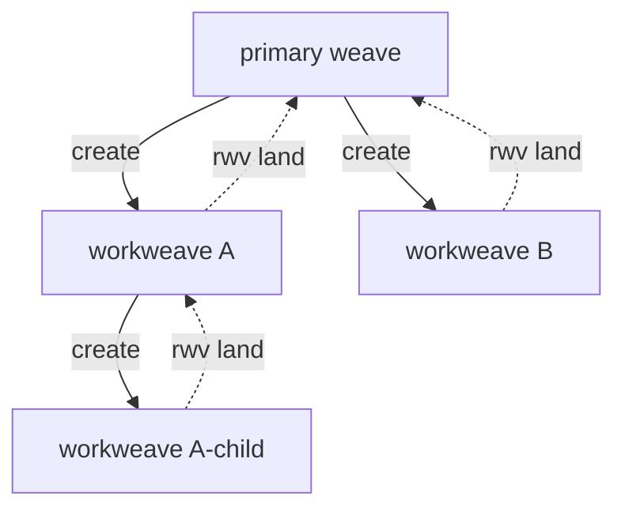

# Workweave hierarchy

A workweave is a worktree-derived copy of a workspace: its own
member-repo branches, its own
ecosystem files, its own tool state.
Workweaves are how repoweave gives operators (and agents) parallel,
isolated cross-repo work without disturbing the primary weave.

Workweaves are not flat. A workweave can be created from inside another
workweave; the result is a tree. This joint explains the tree model, how
flow direction works, and what the tool tracks versus what the operator
must.

## The tree model

The root of the tree is always the primary weave. From there:

```
primary
├── workweave A                ← created from primary
│   └── workweave A-child      ← created from inside A
└── workweave B                ← created from primary
```

Each non-root node was *forked from* a single parent — the workspace
that was CWD when `rwv workweave create` ran. That parent is recorded;
see "Parent tracking" below.

The model is intentionally a tree, not a DAG. A workweave has exactly
one parent. There is no "merge two workweaves into one third one" at the
tool level — that would be a graph operation, and rwv does not own it.
Two sibling workweaves coordinate by syncing through their common
ancestor.

## Flow direction

Work flows along edges of the tree in a specific direction. Creation
runs down the edges (solid); landing runs back up them (dotted):



- **Creation direction** (primary → workweave). `rwv workweave create`
  starts from the current workspace's commits. The child starts pinned to the
  parent's committed lock, and the parent does not switch.
- **Landing direction** (workweave → target). `rwv land` lands the
  child's feature into the branch its record names, which a workweave
  created from another workspace records as that workspace's branch: one
  edge per landing (see below). `rwv sync` goes the
  other direction: a feature takes in the new work of the branch its
  record lands into.

The two directions are not symmetric — see
[sync-semantics](./sync-semantics.md) for the full direction-pair
contract. The flow-direction discipline is *don't skip edges and don't
cross edges*: a child pushes to its parent, not to a sibling or to a
grandparent.

## Parent tracking is tool behavior

The `.rwv-workweave` marker file at every workweave root carries a
`parent` field that records the workspace the workweave was created
from. The shape:

```json
{
  "primary": "/home/user/work/primary",
  "project": "web-app",
  "name": "fix",
  "parent": "/home/user/work/.workweaves/web-app--feat"
}
```

`parent` is `primary` when the workweave was created from the primary
weave, and the parent-workweave path when the workweave was created from
inside another workweave. A legacy marker — YAML, or missing `parent` or
`name` — is refused at read rather than backfilled silently, unless the
project's index lists the workweave, from which the first verb run inside it
writes the marker again; `rwv doctor --fix` migrates it to the current JSON
shape.

Tool-tracked parentage is what makes two operations safe to run without
an explicit target:

1. **`rwv land` has a target.** A workweave's record names the branch
   it lands into: from a child workweave, its parent workweave's branch,
   not the primary's. `rwv sync` names no
   workspace: what it takes in is the branch the checked-out branch's
   record names.
2. **`rwv land --retire` knows what to retire to.** The retire flag
   lands into the record's target, applies the deletion rule, and removes the
   workweave on success.

## One hop, not transitive

`rwv land` lands into the branch the feature's record names. A workweave
created from another workweave records that workweave's branch as its target,
so its landing goes one hop. From a child of a workweave, reaching the
primary's branch takes two landings:

```bash
cd ../.workweaves/web-app--feat-child        # from the primary weave root
rwv land               # → web-app--feat's branch
cd ../web-app--feat
rwv land               # → main
```

`rwv land --target <T>` lands into another branch for one run, when the
operator means it; the record is unchanged.

## What rwv tracks vs. what is discipline

Even with parent tracking, parts of the workweave model remain
operator-managed. Worth being explicit:

| Behavior | Tool support | Discipline |
|---|---|---|
| Recording the parent edge | Yes (`.rwv-workweave`) | — |
| `rwv land` lands into the record's target | Yes | — |
| `rwv land --retire` lands and deletes on success | Yes | — |
| Sibling-to-sibling coordination | No | Land into the shared target |
| Porting a project commit onto a feature | Yes (`rwv cherry-pick`) | — |
| Promotion between branches in the project repo | No | Ordinary git workflow |
| Detecting unusual flow (skip-rebase, sibling sync) | Limited | Operator awareness |

The boundary is consistent with the principle in
[verb-vs-composition](./verb-vs-composition.md): rwv encodes
coordination the manifest knows and the VCS doesn't. The parent edge is
manifest-adjacent (recorded in workspace marker state); siblings are pure
git operations on branches the operator can name. Porting one project
commit is not: it reads the commit's lock against its parent's to find each
member's range, copies those ranges before the project relock, and carries a
dependency's pin rather than copying it, so `rwv cherry-pick` is a verb.

## Naming and paths

Workweaves live under `.workweaves/` in the *parent* of the primary weave
root — i.e. a sibling of the weave root, not a child. That is the
default. The basedir is recorded per-project in
the project clone's workweave index (machine-local JSON, kept with the clone and outside its working tree); relocate
it explicitly with `rwv workweave set-default-create-basedir <path>`,
replace it for one workweave with `rwv workweave create --basedir <path>`,
or place one workweave at exactly a path with `rwv workweave create --dir
<path>`.
Every `find`-direction verb consults the recorded `name → absolute path`
entries rather than reconstructing from convention, so a per-workweave
placement is as first-class as a default-basedir one.
All workweaves for a project — whether forked from primary or from
another workweave — live as flat siblings inside the project's basedir,
named `<project>--<workweave-name>`:

```
work/
├── primary/                      # the primary weave root
└── .workweaves/                  # sibling of the primary weave root
    ├── web-app--feat/            # a workweave forked from primary
    ├── web-app--feat-child/      # a child workweave forked from web-app--feat
    └── web-app--review-pr-42/
```

Concretely, from the primary weave root the workweave directory is at
`../.workweaves/<project>--<name>/`, and sibling or child workweaves are
at `../<project>--<other>/` from inside a workweave. Placing
`.workweaves/` outside the weave root keeps VCS-visible state (`.git/`,
sources) inside the root and rwv-managed sibling checkouts adjacent to
it, so a workspace tree ignores its own workweaves and vice versa.

The `<project>` prefix is part of the directory name (not just metadata)
so multiple projects can host workweaves named identically without
collision. The parent-child hierarchy is recorded in each workweave's
`.rwv-workweave` `parent` field rather than by nesting directories on
disk.

## Ephemeral branch names and the git worktree constraint

By default each workweave runs on a flat per-workweave minted branch name — e.g.
`web-app--hotfix` (or `chatly+web-app--hotfix` for a scoped project)
rather than `main`. This is what lets `rwv land` work cleanly as a
local-to-local primitive.

Git imposes a constraint: only one worktree can have a given branch
checked out at a time. If two workweaves both tracked `main`, checking
out the second would require the first to detach its HEAD, and the
sequence `land` into `main` would be trying to push into a branch another
worktree owns. The analogous single-repo operation — `git push
<local-path> feature:main` — is similarly awkward when `main` is already
checked out at the destination.

rwv sidesteps this entirely. Because primary's `main` and a workweave's
`web-app--hotfix` are different branch names, no two
workweaves compete for the same named branch. `rwv land` can push
directly into primary's `main` without any detach-or-stash dance. The
ephemeral naming scheme is not just bookkeeping — it is what makes
`land` a clean primitive where the single-repo git analog is not.

## A workweave's branch is recorded

Creating a workweave with no branch flag records its minted branch as a **feature onto the
branch the workspace it was forked from has checked out**, with that branch's
mode as it stands: `rwv workweave create` from a primary on `main`, which is
`declared`, records `{ target: main, as: declared }`, and reports where the
branch lands (`target-recorded`). A workweave made from inside another
workweave targets that workweave's branch. The record is the one statement of
how the workweave's branch is used, so the verbs that align, lock, land or
publish read it, and a branch without one is refused.

The parent's own branch must have a record that reads as one value, else the
create refuses before it makes anything, naming `rwv branch set-mode` for that
branch. From a project repo on a detached HEAD there is no branch to land
into, and the create refuses. Re-running `rwv workweave create` on a workweave
that exists records its branch when a half-finished create left it without
one.

## Related joints

- [workweave-lifecycle](./workweave-lifecycle.md) — what happens at each
  stage of a workweave's existence: creation flags, working state, the
  retire contract, and deletion semantics.
- [records and modes](./branch-records.md) — the record that names each
  workweave branch's target.
- [landing](./landing.md) — what one landing edge composes and moves.
- [sync-semantics](./sync-semantics.md) — taking the target's work into a
  feature; the other direction of the pair.
- [clone-topology](./clone-topology.md) — the ephemeral-branch
  convention is invariant I3 in the tier-0 topology spec; the
  hierarchy's worktree-sharing model is the physical artifact those
  invariants govern, for every repo whatever its role.
- [verb-vs-composition](./verb-vs-composition.md) — why "sync through
  sibling" / "cross-pick across workweaves" aren't rwv verbs.
