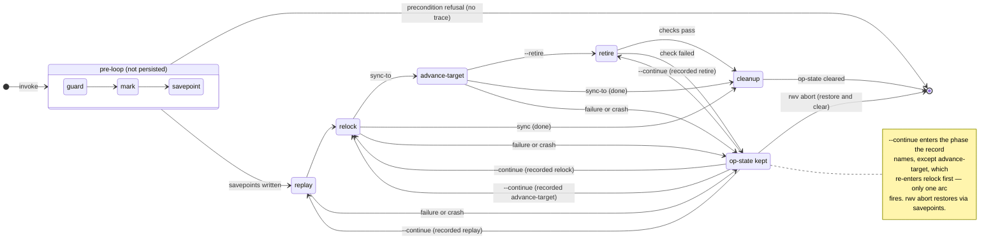

# The sync phase machine

> **Implementation, not interface.** Nothing in this document is a stable
> surface: the structures described here may change without notice, and
> operating on them directly — with shell tools, file edits, or git commands
> against rwv-managed state — is not supported. Operations on or between
> workweaves go through rwv verbs. If you need an operation no verb provides,
> that is a UX gap: file it rather than working around it at the file level.

The per-phase contract behind `rwv sync` and `rwv sync-to`, for someone
changing `src/sync.rs`: what each phase does, what it persists, and the
re-entry rule that makes `--continue` safe. The operator contract — the
direction pair, what the phases mean to an operator, abort's guarantees and
the strategy choice — is
[`../explanation/joints/sync-semantics.md`](../explanation/joints/sync-semantics.md).
The schemas of the `.rwv-op` owner record and the `.rwv-op-lease` pointer are
in [`op-state.md`](./op-state.md).

## Execution order and persistence

```
guard → mark → savepoint → replay → relock → advance-target → retire → cleanup
                                              (sync-to only)   (--retire only)
```

The diagram shows the states a sync operation can be in. The gray box
(`guard → mark → savepoint`) runs once before the driver loop and is not
persisted; a crash there leaves no trace. The white states (`replay`
onward) are the phases the driver persists in `.rwv-op`.



**Op-state lifecycle:**

| Exit path | Owner record + leases |
|---|---|
| Precondition refusal (guard, before any mutation) | No trace left |
| All phases complete (cleanup) | Cleared everywhere |
| Phase failure or crash | Kept everywhere; `--continue` resumes, `rwv abort` restores |
| `retire` check failure | Kept at `retire` phase; `--continue` retries checks |
| `rwv abort` completes | Cleared after verified restore |

The guard, mark, and savepoint steps run once before the driver loop.
The persisted record then names which phase the driver is in — the
single source of truth for op state. The record never runs ahead of
completed work, so a crash at any instruction resumes at a phase that
is safe to re-run (idempotent by construction). `--continue` for both
verbs is:
load the owner record (following a lease pointer if invoked from a
non-owner workspace), enter the driver loop.

One phase is not re-entered where it was recorded. A resume at
advance-target re-enters relock first, and the rewind is persisted before
the loop reads it, so the record stays the single source of truth.
Advance-target publishes CWD's manifest tips and CWD's lock together, and
relock is what makes those two agree; resolving whatever stranded the op
means moving CWD, which breaks the agreement relock had already reached.
Re-entering relock gives the resumed path the property the fresh path has
by construction — relock ran immediately before advance-target, with no
operator window between them. Retire is entered as recorded: the target
is already advanced by then, and retire's merged-check refuses a CWD that
moved rather than publishing it.

## guard

Runs all preconditions before any mutation. Covers: no-op-in-progress
check on every workspace the op will touch, replay-exclusion invariant
(`rwv.lock merge=rwv-ours` in committed `.gitattributes`), lock freshness,
Phase 1' ancestor check (`--strategy=ff`), and the dirty-target
preflight (`rwv sync-to`). Refusals here leave no trace.

**Acquisition atomicity.** The no-op-in-progress check is not
a plain read followed by a later write. `sync` / `sync-to` acquire the
owner record and every touched-workspace lease **atomically at guard
time** via `O_CREAT|O_EXCL`: the OS refuses the second creator, so two
concurrent invocations cannot both pass the guard and only collide later
at the git layer. On `AlreadyExists`, the caller sees the standard
in-flight refusal (verb, age, phase, `--continue` / `rwv abort` exits)
reading the *existing* holder. Every precondition that follows runs
after acquisition; on refusal, the acquired records are cleared, which
is the op-state lifecycle table's "no trace left" row. Content is
published via a sibling temp file + `link(2)` so a loser never reads a
half-written owner file.

Time is never a decision input: crash between acquisition and Mark
leaves records with no savepoints. That partial state is diagnosed by
the doctor's structural dead-lease check (a `.rwv-op-lease` whose
recorded owner workspace has no matching `.rwv-op` for the same op id
is provably dead — safe to auto-fix by removing the lease file).
Elapsed time is surfaced to the operator as observability, never
consumed as a timeout.

## mark

Update the owner record with any acquisition-time overrides
(`allow-stale-lock`, `discard-local-commits`) that the preconditions
determined applied, then continue to Savepoint. The owner record + leases
themselves were written by the atomic acquisition in the guard step
above; Mark is the field-refinement write, not the first write.
Source workspaces are read-only and receive no mark — safe because reads
are snapshots (the joint's "Snapshot reads", and "Snapshot-read internals"
below).

## savepoint

Write a durable pre-op snapshot reference in every repo the op may
mutate, under `refs/rwv/pre-op/<op-id>`. The op-id is nanosecond
wall-clock so concurrent or interleaved invocations cannot collide.

For `rwv sync-to`, target-workspace repos are savepointed under
`refs/rwv/pre-op/<op-id>-target` — a separate namespace from the
source-side `refs/rwv/pre-op/<op-id>`. When both sides share a git
object store (worktree topology), a single namespace would collide:
the first restore during `rwv abort` would drop the ref, leaving the
second restore unable to find it. The `-target` suffix ensures abort can
restore both sides independently.

## replay

Runs **Phase 1'** (project repo) followed by **Phase 2** (member repos) — the project-repo step is called *Phase 1'* because it runs ahead of Phase 2 so the replayed `rwv.toml` determines which member checkouts exist before Phase 2 advances them and Phase 3 (`relock`) snapshots their tips:

- **Phase 1' — project repo, lock-excluded**: replay CWD's unique
  project commits onto the named workspace's project tip using
  `--strategy`, with `rwv.lock` excluded from each commit's effective
  diff. With `--strategy=rebase`, lock-only commits become empty patches
  and are dropped by git's `--empty=drop`. With `--strategy=ff`, the
  branch pointer advances without replaying anything.

- **Phase 2 — member repos**: advance each of CWD's member repo
  branches to the named workspace's lock target, using the chosen
  `--strategy`. Exception: a plain `sync` from a workweave source whose
  lock is behind its committed HEAD targets that source's committed tips
  instead (tips-as-truth — a note names the lag, and the source's lock
  is left alone for its own next op to heal). `sync-to` gets no such
  exception: a target whose lock is behind its committed HEAD is refused
  at op start, naming the target repo, its commit count and the
  `rwv lock --commit` that fixes it, because replaying CWD against that
  lock would leave the target's unlocked commits out of CWD's tip and
  advance-target could not fast-forward onto it. Repos already at the
  target SHA are no-ops. Repos behind
  the target are advanced via the strategy (ff / rebase). Repos
  ahead of the target surface as `already-ahead` — the engine does not
  silently rewind CWD's working state. That outcome names two relations
  against the same baseline: CWD's, and the source checkout's own. A repo
  containing the baseline has not thereby caught up with the source, and
  a line stating only the first reads as though it had.

**Replay's member set follows the manifest Phase 1' produces.** Once the
project repo has replayed, its `rwv.toml` is the manifest CWD ends the op
with, and it alone decides which checkouts replay adds and removes. A
member the source's lock names, this manifest names, and CWD lacks on disk
is materialized before Phase 2 advances anything, born at its replay
target. A member CWD's manifest named when the op started and this
manifest no longer names is pruned, behind the dirty, unique-commit and
store-claim refusals. A member it still names is kept, with a `kept` line
when the source's lock lacks it. So a member CWD dropped is not brought
back because the source still names it, and a member CWD added, or
dropped and added back, survives a source that dropped it. Histories with
no commit in common follow the same rule: Phase 1' replays the whole of
CWD's history, so CWD's members stay in the manifest.
`--discard-local-commits` hands CWD the source's manifest, so every member
that manifest lacks is pruned. Role plays no part.

**Nothing is pruned until every repo has replayed.** The prune runs after
Phase 2, so an op that parks, on a project-repo conflict or a
member-repo one, has removed no checkout yet, and the prune runs on
`--continue`. `rwv abort` restores refs and cannot bring back a deleted
checkout, so this ordering is what lets an aborted op leave CWD's
checkouts as it found them.

**A pull does not refuse a destination whose own lock is behind its
HEAD.** That lock is not replay's input — the targets come from the
source — and relock regenerates it at op end, so the gate was refusing
to start over a condition the op's own last phase establishes. The
relation is announced per repo rather than accepted silently. Every
other non-`ok` destination relation still refuses.

Two narrower alternatives were rejected. Naming `--strategy rebase` in
the freshness refusal *without* relaxing leaves the operator three
commands deep on the single most routine operation in the tool, and the
refusal's own prescribed remedy (`rwv lock --commit`) lands a
destination-only project commit that the ancestry gate then refuses —
the two preconditions were mutually unsatisfiable for the bare form.
Teaching the ancestry gate to ignore a destination-only lock-only
commit does not work under `ff` at all: there is no replay to exclude
`rwv.lock` from, the destination is no longer an ancestor of the
source, and honoring it would mean resetting past a commit the
operator made — `--discard-local-commits` minted silently. The
`rwv.lock`-excluded property the remedy relies on belongs to replay,
and `ff` has no replay.

The relaxation is not scoped to workweave destinations the
way tips-as-truth is scoped to workweave sources. That scoping answers
"may this op consume another workspace's unblessed commits?"; the
destination question is whether the operator's own workspace may start
an op while its own lock lags, and nothing about it is published
anywhere. A primary weave deadlocks identically, so scoping would have
kept two tests green and left the trap in place.

Unlike `sync-to`'s CWD there is no op-start relock on a pull: the
destination's project repo is itself a replay target, and a relock
commit made before Phase 1' would leave `--strategy=ff` a project repo
it can no longer fast-forward.

Re-entry rule: per-repo state is derived from the VCS itself. A repo
at its savepoint is redone; a repo mid-conflict resumes via the
VCS-native continue; a repo already at the converged target is a no-op.
No resume flags.

`--strategy=ff` with `rwv sync-to`: replay is a no-op (CWD must be
strictly ahead of target per the guard's ff precondition); the
advance-target phase does all the work.

## relock

Regenerate `rwv.lock` from the post-replay manifest tips in CWD. If
the result differs from what is currently committed, the engine commits
it automatically with a message like `lock: auto-relock after sync from
<named-workspace>`.

On completion, record the per-repo **converged tips** in the owner
record: the HEAD of each member repo and the project repo, keyed by
repo path (e.g. `github/foo/bar`) and `"(project)"`. These are consumed
by advance-target and by abort's HEAD-verified restore.

Re-entry rule: regenerating a lock that is already current is a no-op.

Relock runs under every verb and strategy. `--strategy=ff` makes replay a
no-op, not this phase: whatever last moved CWD's member repos — an
operator's fix between a stranded op and its resume, most of all — leaves
a lock that no longer pins them, and advance-target publishes that lock.

## advance-target (sync-to only)

FF-advance every member repo and the project repo in the target
workspace to CWD's converged tips (written during relock). This step is
always fast-forward regardless of `--strategy` — all rewriting happened
in CWD during replay.

Re-entry rule: ff to an already-reached tip is a no-op.

**Ordering rule: member repos first, project repo last, and the project
advance is gated on all of them landing.** The project repo carries the
lock and the lock names the manifest tips, so advancing it past a
member repo that did not land would leave the target asserting
revisions it does not hold — the one target state no later phase
repairs. Member repos that did land stay landed: their pre-op
revisions are ancestors of what the target now holds, so the
un-advanced lock remains true about them, and it is the benign
lock-behind-HEAD shape `rwv lock --commit` refreshes.

Rolling the landed repos back instead was rejected. `rwv abort` is
already the transactional exit, is savepoint-verified, and is named in
the failure. A second, implicit rollback would write to the target at
the moment least is known about why the landing failed, and would fight
the idempotent re-entry rule a `--continue` depends on.

## retire (--retire only)

Refuse first while replay left a checkout it could not prune
(`refuse_retiring_unpruned_checkouts`, `RefusalKind::RetireUnprunedCheckout`):
deleting the workweave would destroy what the prune refused to. Then run the
merged-check (member repo tips equal in CWD and target after the preceding
advance-target) and the dirty-check (no checkout under the workweave has
uncommitted changes, a manifest member or not), then delete the workweave.
A failure from any of the three preserves the op record at phase `retire` —
`--continue` retries after the operator reconciles; `rwv abort` rolls back
the whole op, target included. The removal itself is idempotent (a missing
workweave directory is a no-op).

The unpruned set is `stranded_checkouts`: the repos CWD's manifest named
when the op started (read at the project savepoint), named by no manifest
now, and still on disk. It is derived rather than carried from replay, so a
`--continue` that re-entered past replay weighs the same set. The same set
decides a completed op's exit: when it is non-empty after cleanup, the op
has cleared its op-state and `fail_on_stranded_checkouts` exits 1 naming the
checkouts, since nothing the op can still do repairs them.

Retire compares **member repo tips** rather than project repo tips.
The project repo's post-sync state can diverge from the target by
exactly the auto-relock commit Phase 3 writes. That commit is purely
derived, so manifest tip equality is the accurate "work has converged"
signal.

Retire is only meaningful inside a workweave. Run from a primary weave,
it emits a warning and is otherwise a no-op.

## cleanup

Drop all savepoints and clear the owner record and lease. Cleanup is
not a persisted phase: a crash before cleanup completes leaves the
on-disk phase at the last work phase (idempotent), and `--continue`
re-runs that phase before reaching cleanup again.

Exception: when `--discard-local-commits` discarded project commits
(recorded as the `discard-local-commits` override), the project
savepoint is preserved as a tombstone even after the sync completes —
the only remaining reference to the discarded commits (`rwv abort` will
refuse once op-state is cleared, but `git reset --hard refs/rwv/pre-op/<op-id>`
in the project repo still recovers them). Member-repo savepoints are
dropped regardless.

## Abort internals

The operator contract — savepoints, the two rails, the foreign-tip refusal
and `--abandon-foreign-tip` — is on the joint. What follows is how abort
attributes a tip and what it prints.

The destructive `reset --hard` to the savepoint is gated on the repo's
current tip being **attributable to the op**. The attributable set is
`{savepoint, advanced_tips[repo], converged_tips[repo], VCS-native mid-op}`.
A repo with no savepoint for the op is `NoSavepoint` and skipped. The
classification of the rest:

| Current tip | Outcome |
|---|---|
| Equal to the savepoint | `Untouched` — op never moved this repo; HEAD not touched |
| Equal to `advanced_tips[repo]` (the op's recorded intent tip) | `RestoredFromIntent` — op advanced this repo during replay; reset to savepoint |
| Equal to `converged_tips[repo]` (the recorded converged tip) | `RestoredFromConverged` — op converged this repo; reset to savepoint |
| Repo is in a VCS-native mid-op state (rebase / merge / cherry-pick) | `RestoredFromMidOp` — mid-op canceled; reset to savepoint |
| Anything else | `ForeignTip` — restore **refused**; violation reported; op-state retained |
| Anything else, with `--abandon-foreign-tip` naming the repo and the pre-abort ref holding that tip | `AbandonedForeignTip` — reset to savepoint; the tip stays reachable at the pre-abort ref |

**`advanced_tips` — the advancement-intent journal.** The `advanced_tips`
owner-record map closes the mid-replay attribution gap. It is written during
the replay phase in two passes:

1. **Pre-advance (ff-movers):** at replay entry, the planned target SHA is
   written for every repo whose advance is a genuine fast-forward (current ⊏
   target) — before the fan-out. This is a true write-ahead log: the intent
   precedes the advance, so the landing tip always equals the recorded target
   and there is no window.

2. **Post-advance (rebased repos):** because a rebase lands at a fresh SHA
   unknowable before the rebase runs, the actual tip is captured right after
   the rebase succeeds — for the project repo (serial Phase 1') immediately,
   for parallel member repos in a single batch-write after the fan-out
   joins.

`advanced_tips` is cleared in the same atomic owner-record persist that
writes `converged_tips` at relock completion. This means mid-replay crashes
where the op cleanly advanced repos no longer produce foreign-tip refusals on
those repos — they auto-restore as `RestoredFromIntent` (reported as
`restored (from recorded intent tip)`).

**Residual foreign-tip case.** After `advanced_tips` lands, `ForeignTip`
fires only for genuinely-foreign tips (e.g. an operator commit made after the
crash), plus the irreducible one-write window between a rebase completing and
its tip being persisted into `advanced_tips`. That window is an irreducible
floor: the tip cannot be recorded before it exists.
During that instant abort treats the repo as foreign — it refuses that one
repo and preserves its tip at the pre-abort ref.

**Refusal output.** When `ForeignTip` fires, abort emits to stderr (per
repo): a one-line noise summary (skipped/untouched repos), per-refused-repo
blocking commits (`git log savepoint..tip`, capped at 5 with a remainder
count) plus a shape line (strictly-ahead vs diverged), and the
recovery-options block printed exactly once at the end. The options block
contains only operator-facing choices: a tip the op itself converged is
attributable through `advanced_tips` and `converged_tips`, so it needs no
option.

### Pre-abort ref writes

A pre-abort ref that already exists for this op, from an earlier abort
attempt, is returned unchanged rather than overwritten: the earlier capture
is the more valuable one, and by the time abort is re-run it may be the only
remaining reference to that tip. `Vcs::create_pre_abort_ref` resolves the ref
first and skips the write when it exists.

The one exception is the abandon path. When the operator passed
`--abandon-foreign-tip` for the repo and the existing capture is a strict
ancestor of HEAD, the ref advances to HEAD: the earlier capture stays
reachable from the new one, so no commit loses its only name. A capture that
has diverged from HEAD (a foreign rebase or reset) is returned unchanged,
and `verified_restore_savepoint` then refuses the abandon, naming the two
ways to reconcile.

## Snapshot-read internals

The source pin is one `HEAD` resolution of the source project repo; the
manifest and lock are then read at that revision through
`Vcs::read_file_at_revision` (git: `git show <rev>:<path>`).

**The tips-as-truth pull is the one read that is not content-addressed.**
A member checkout's committed tip is a live ref, so it is read at T₀
alongside the project `HEAD` and carried on the snapshot. The source's
lock↔HEAD classification is taken exactly once there, and everything
downstream — the staleness refusals, the note naming the lag, and the
per-repo replay targets — reads that one result. Classifying a second
time to serve a second surface reads the refs at a second instant: a
member that is `Ok` at the first read and `Ahead` at the second pins no
tip, so replay targets the lock while the note announces committed tips.
The op guard does not exclude a plain `git commit` into the source, and
that is precisely the scenario tips-as-truth exists for, so the window is
reachable rather than theoretical.

## Replay exclusion: three layers

`--strategy=rebase` requires `rwv.lock merge=rwv-ours`
in the project repo's **committed** `.gitattributes`, though no `merge`
*strategy* exists: git rebase replays each commit as a 3-way merge against
the new base, so the
`merge=rwv-ours` driver is what keeps a lock-only commit from conflicting
on `rwv.lock` during replay. Three layers keep the exclusion active:

1. The committed `.gitattributes` line `rwv.lock merge=rwv-ours` assigns the
   driver to `rwv.lock`.
2. `rwv` passes `-c merge.rwv-ours.driver=true` on each `git rebase` and
   `git rebase --continue` invocation (defines the driver for that process).
3. Before each rebase-strategy sync, rwv plants a durable
   `merge.rwv-ours.driver=true` repo-local config in the project repo, so
   bare `git rebase --continue` — the fallback resume path — is safe
   without rwv's inline flags.

Layer 3 reaches the project repo only. A repo that adopts the same
declaration for its own derived content gets layers 1 and 2 and no plant,
so a hand-run merge or rebase there falls back to an ordinary textual
conflict every time rather than in an edge case — noisy, but decided
either way by the regeneration that follows. That asymmetry is stated in
full in [vcs-as-seam](../explanation/joints/vcs-as-seam.md).

The check fires against the committed file
(via `git show HEAD:.gitattributes`), not the working tree, because the
invariant must survive rebases. Run `rwv doctor --fix` to add the line
(or migrate a legacy `merge=ours` spelling).

## VCS mapping (git)

This document is written VCS-neutrally. The git realization of each
mechanism is:

| Neutral mechanism | Git realization |
|---|---|
| Durable pre-op snapshot reference | `refs/rwv/pre-op/<op-id>` |
| Target-side pre-op snapshot reference | `refs/rwv/pre-op/<op-id>-target` |
| Pre-abort reference | `refs/rwv/pre-abort/<op-id>` |
| Target-side pre-abort reference | `refs/rwv/pre-abort/<op-id>-target` |
| VCS-native mid-op state / continue / abort | rebase/cherry-pick state dirs; `--continue` / `--abort` |
| Atomic source pin (T₀) | one `HEAD` resolution of the source project repo |
| Read manifest/lock at a revision | `git show <rev>:<path>` (`Vcs::read_file_at_revision`) |
| ff-advance to converged tip | `git merge --ff-only <rev>` (never `reset --hard`) |
| Capture post-rebase tip for `advanced_tips` | `HEAD` resolution immediately after `git rebase` succeeds |
| Verified restore | `git reset --hard <savepoint>` gated on tip ∈ {savepoint, advanced tip, converged tip, mid-op} |
| Object transfer of pinned revisions | shared object store (worktrees: no-op) |
| Lock replay-exclusion (rebase) | `rwv.lock merge=rwv-ours` in `.gitattributes`; `-c merge.rwv-ours.driver=true` per invocation; durable `merge.rwv-ours.driver` repo-local config planted before each sync (project repo only) |

All of these are intent-named `Vcs` trait methods; the phase machine
contains no VCS-specific spellings.

## The bare-sync refusal

`rwv sync` has no "absorb from parent" default, and the prohibition lives
entirely in argument parsing: `<SOURCE>` is a required CLI argument, and the
engine has no branch that reads the marker's parent for a pull.
`e2e_two_workweaves_test.rs`'s
`bare_sync_inside_a_workweave_is_refused_at_argument_parsing` pins both the
refusal and the non-movement, so re-adding the default is a red test rather
than a quiet resurrection.
