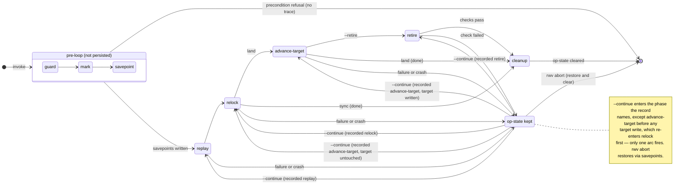

# The sync phase machine

> **Implementation, not interface.** Nothing in this document is a stable
> surface: the structures described here may change without notice, and
> operating on them directly — with shell tools, file edits, or git commands
> against rwv-managed state — is not supported. Operations on or between
> workweaves go through rwv verbs. If you need an operation no verb provides,
> that is a UX gap: file it rather than working around it at the file level.

The per-phase contract behind `rwv land`, for someone changing
`src/sync.rs`. `rwv sync` no longer runs this machine; its contract is the
last section below. For `land`: what each phase does, what it persists, and the
re-entry rule that makes `--continue` safe. The operator contract — the
direction pair, what the phases mean to an operator, abort's guarantees and
the history setting — is
[`../explanation/joints/sync-semantics.md`](../explanation/joints/sync-semantics.md).
The schemas of the `.rwv-op` owner record and the `.rwv-op-lease` pointer are
in [`op-state.md`](./op-state.md).

## Execution order and persistence

```
guard → mark → savepoint → replay → relock → advance-target → retire → cleanup
                                              (land only)   (--retire only)
```

The diagram shows the states a sync operation can be in. The gray box
(`guard → mark → savepoint`) runs once before the driver loop and is not
persisted; a crash there leaves no trace. The white states (`replay`
onward) are the phases the driver persists in `.rwv-op`.



**Op-state lifecycle:**

| Exit path | Owner record + leases |
|---|---|
| Precondition refusal (guard, before any mutation) | No trace left |
| All phases complete (cleanup) | Cleared everywhere |
| Phase failure or crash | Kept everywhere; `--continue` resumes, `rwv abort` restores |
| `retire` check failure | Kept at `retire` phase; `--continue` retries checks |
| `rwv abort` completes | Cleared after verified restore |

The guard, mark, and savepoint steps run once before the driver loop.
The persisted record then names which phase the driver is in — the
single source of truth for op state. The record never runs ahead of
completed work, so a crash at any instruction resumes at a phase that
is safe to re-run (idempotent by construction). `--continue` for both
verbs is:
load the owner record (following a lease pointer if invoked from a
non-owner workspace), enter the driver loop.

One phase is not re-entered where it was recorded. A resume at
advance-target re-enters relock first, and the rewind is persisted before
the loop reads it, so the record stays the single source of truth.
Advance-target publishes CWD's manifest tips and CWD's lock together, and
relock is what makes those two agree; resolving whatever stranded the op
means moving CWD, which breaks the agreement relock had already reached.
Re-entering relock gives the resumed path the property the fresh path has
by construction — relock ran immediately before advance-target, with no
operator window between them. Retire is entered as recorded: the target
is already advanced by then, and retire's merged-check refuses a CWD that
moved rather than publishing it.

Advance-target is entered as recorded once the landing journaled any write
to the target (a checkout, a ref, a created branch). Those writes carry the
composed tips, so a re-composed table would make the landing's own moves
read as a race, and land a mix of two compositions. The resumed landing
completes the one it began: it reaches the result an uninterrupted landing
reaches, moves no ref twice, and leaves what CWD gained after the stop for
the next landing.

## guard

Runs all preconditions before any mutation. Covers: no-op-in-progress
check on every workspace the op will touch, the lock merge driver's setup
(dispatch judges the workspace; the guard judges
the source's project checkout, whose committed `.gitattributes` governs the
replay), lock freshness,
the history setting of each repo `land::judge` plans (unset,
contradicted, not fast-forward under `ff-only`, and which repos compose by a
merge commit, recorded in the plan's `merged`), and the dirty-target
preflight (`rwv land`). Refusals here leave no trace.

**Acquisition atomicity.** The no-op-in-progress check is not
a plain read followed by a later write. `sync` / `land` acquire the
owner record and every touched-workspace lease **atomically at guard
time** via `O_CREAT|O_EXCL`: the OS refuses the second creator, so two
concurrent invocations cannot both pass the guard and only collide later
at the git layer. On `AlreadyExists`, the caller sees the standard
in-flight refusal (verb, age, phase, `--continue` / `rwv abort` exits)
reading the *existing* holder. Every precondition that follows runs
after acquisition; on refusal, the acquired records are cleared, which
is the op-state lifecycle table's "no trace left" row. Content is
published via a sibling temp file + `link(2)` so a loser never reads a
half-written owner file.

Time is never a decision input: crash between acquisition and Mark
leaves records with no savepoints. That partial state is diagnosed by
the doctor's structural dead-lease check (a `.rwv-op-lease` whose
recorded owner workspace has no matching `.rwv-op` for the same op id
is provably dead — safe to auto-fix by removing the lease file).
Elapsed time is surfaced to the operator as observability, never
consumed as a timeout.

## The landing's plan

`land::resolve` reads the feature's record, its target `T`, `T`'s tip (the
newer of `T` and its upstream) and the workspace that has `T` checked out,
before the op is acquired. `land::judge`, inside the guard, plans each
`owned` or `fork` member's receiving branch `U` and its tip, and judges every
refusal the landing owes — the record changed elsewhere, `as` against `T`'s
mode now, the lineage rule, `U` reaching `T`'s pin, `U`'s checkout in `T`'s
workspace, changes to `T`'s entries, dependents, protection — into one
report with the edits, alignment and pin judgments of both workspaces.
Nothing moves until that report is empty.

The plan is written to the owner record's `take_in`: `sync_from` names `T`,
`receiving` holds, under `(project)`, the branch `T` and its tip, and under
each planned member's path its receiving branch `U`, that branch's tip and
how it moves (in its checkout, as a ref and perhaps created, created for a
member `T` lacks, or followed with nothing moving),
and `source_tip` the source's project tip once the op-start relock
committed. Replay composes each planned member onto its tip and nothing
else; relock merges pins three ways against the merge base of `source_tip`
and `T`'s tip, each planned member at its composed tip, and records every
composed tip as the op's converged tips; advance-target fast-forwards only
the planned members and the project repo, each on exactly the branch the
plan names and to exactly its converged tip, never to whatever the source
checkout holds by then. A `--continue` reads the plan back and, before any
phase, refuses when a checkout the plan fast-forwards is no longer on the
branch it names, or that branch no longer fast-forwards to what the record
holds for it (`target` moved mid-operation): the plan no longer describes
the landing. Advance-target judges the same, per repo, at the moment it
moves each one, and again when the move itself fails, so a branch moved
between that judgment and the move is the same state. Each repo of `T`'s
workspace it moves, by its fast-forward, by moving a receiving branch as a
ref, or by aligning `T`'s workspace after it, is added to
`take_in.moved_in_target` before it moves, and taken back off where the
move stopped first.

## mark

Update the owner record with any consents the run was given, then continue
to Savepoint. The owner record + leases
themselves were written by the atomic acquisition in the guard step
above; Mark is the field-refinement write, not the first write.
Source workspaces are read-only and receive no mark — safe because reads
are snapshots (the joint's "Snapshot reads", and "Snapshot-read internals"
below).

## savepoint

Write a durable pre-op snapshot reference for every ref the op may
move, under `refs/rwv/pre-op/<op-id>`: each checkout's HEAD with the branch
it is on, and, for `rwv land`, each receiving branch it will move as a ref
(no checkout holds it), at the tip the landing read, and, where the target
is checked out nowhere, the target's project branch likewise. The op-id is
nanosecond wall-clock so concurrent or interleaved invocations cannot
collide.

For `rwv land`, target-workspace repos are savepointed under
`refs/rwv/pre-op/<op-id>-target` — a separate namespace from the
source-side `refs/rwv/pre-op/<op-id>`. When both sides share a git
object store (worktree topology), a single namespace would collide:
the first restore during `rwv abort` would drop the ref, leaving the
second restore unable to find it. The `-target` suffix ensures abort can
restore both sides independently.

## replay

Runs **Phase 1'** (project repo) followed by **Phase 2** (member repos) — the project-repo step is called *Phase 1'* because it runs ahead of Phase 2 so the replayed `rwv.toml` determines which member checkouts exist before Phase 2 advances them and Phase 3 (`relock`) snapshots their tips:

- **Phase 1' — project repo, lock-excluded**: replay CWD's unique
  project commits onto the named workspace's project tip, as the plan
  records: rebased with the target side's `rwv.lock` held through the
  replay and every replayed commit kept (`DerivedContentPolicy::rewritten_after`),
  the rebase journaled first (`TakeInRecord.rebases`); or, for a repo in the plan's `merged`, joined by a merge commit
  whose first parent is the target's tip (`sync::compose_merge`), the lock
  merge driver held so the source's lock survives for relock. A tip that
  already holds the target's on its first-parent chain moves nothing.

- **Pin re-map**, once Phase 2 is done: each project commit Phase 1'
  replayed is rewritten so its lock pins what the journaled member rebases
  made of the commits it pinned (`remap::remap_rebased_project`, reading
  each rebase back through `Vcs::replayed`, so a rebase finished by the
  VCS's own continue reads the same); a commit left changing nothing is
  dropped. `rwv abort` reads a tip that is a replay of a journaled rebase as
  the op's own.

- **Stack carry**, once the feature's own branches are final (`rwv sync`
  after its relock; `rwv land` at the end of `relock`): `stack::Carrier`
  walks the records for the feature's dependents, refuses with one `target`
  dependent state each where one cannot be carried, then replays each
  dependent detached in the source's checkout of every repo the feature was
  rewritten in (members before the project branch, whose pins it re-maps),
  journaling each as `TakeInRecord.carries` before it starts and recording
  the tip it composed; the checkout returns to the branch it was on. Only
  then does each dependent's branch move, by compare-and-swap after a
  `rebased` backup, the move journaled in `ref_moves` for `rwv abort`. A
  stop on a carry is finished by `Carrier::finish_stopped` before anything
  reads the checkouts on `--continue`.

- **Phase 2 — member repos**: advance each of CWD's member repo
  branches to the named workspace's lock target, rebased or merged as the
  plan records, a `rebased` backup kept first for each branch a rebase
  rewrites. Exception: a plain `sync` from a workweave source whose
  lock is behind its committed HEAD targets that source's committed tips
  instead (tips-as-truth — a note names the lag, and the source's lock
  is left alone for its own next op to heal). `land` gets no such
  exception: a target whose lock is behind its committed HEAD is refused
  at op start, naming the target repo, its commit count and the
  `rwv lock --commit` that fixes it, because replaying CWD against that
  lock would leave the target's unlocked commits out of CWD's tip and
  advance-target could not fast-forward onto it. Repos already at the
  target SHA are no-ops. Repos behind
  the target are fast-forwarded. Repos
  ahead of the target surface as `already-ahead` — the engine does not
  silently rewind CWD's working state. That outcome names two relations
  against the same baseline: CWD's, and the source checkout's own. A repo
  containing the baseline has not thereby caught up with the source, and
  a line stating only the first reads as though it had.

**Replay's member set follows the manifest Phase 1' produces.** Once the
project repo has replayed, its `rwv.toml` is the manifest CWD ends the op
with, and it alone decides which checkouts replay adds and removes. A
member the source's lock names, this manifest names, and CWD lacks on disk
is materialized before Phase 2 advances anything, born at its replay
target. A member CWD's manifest named when the op started and this
manifest no longer names is pruned, behind the dirty, unique-commit and
store-claim refusals. A member it still names is kept, with a `kept` line
when the source's lock lacks it. So a member CWD dropped is not brought
back because the source still names it, and a member CWD added, or
dropped and added back, survives a source that dropped it. Histories with
no commit in common follow the same rule: Phase 1' replays the whole of
CWD's history, so CWD's members stay in the manifest.
Role plays no part.

**Nothing is pruned until every repo has replayed.** The prune runs after
Phase 2, so an op that parks, on a project-repo conflict or a
member-repo one, has removed no checkout yet, and the prune runs on
`--continue`. `rwv abort` restores refs and cannot bring back a deleted
checkout, so this ordering is what lets an aborted op leave CWD's
checkouts as it found them.

**A pull does not refuse a destination whose own lock is behind its
HEAD.** That lock is not replay's input — the targets come from the
source — and relock regenerates it at op end, so the gate was refusing
to start over a condition the op's own last phase establishes. The
relation is announced per repo rather than accepted silently. Every
other non-`ok` destination relation still refuses.

Two narrower alternatives were rejected. Naming a rebase in
the freshness refusal *without* relaxing leaves the operator three
commands deep on the single most routine operation in the tool, and the
refusal's own prescribed remedy (`rwv lock --commit`) lands a
destination-only project commit that the ancestry gate then refuses —
the two preconditions were mutually unsatisfiable for the bare form.
Teaching the ancestry gate to ignore a destination-only lock-only
commit does not work for a fast-forward at all: there is no replay to exclude
`rwv.lock` from, the destination is no longer an ancestor of the
source, and honoring it would mean resetting past a commit the
operator made. The
`rwv.lock`-excluded property the remedy relies on belongs to replay,
and a fast-forward has no replay.

The relaxation is not scoped to workweave destinations the
way tips-as-truth is scoped to workweave sources. That scoping answers
"may this op consume another workspace's unblessed commits?"; the
destination question is whether the operator's own workspace may start
an op while its own lock lags, and nothing about it is published
anywhere. A primary weave deadlocks identically, so scoping would have
kept two tests green and left the trap in place.

Unlike `land`'s CWD there is no op-start relock on a pull: the
destination's project repo is itself a replay target, and a relock
commit made before Phase 1' would leave a project repo it can no longer
fast-forward.

Re-entry rule: per-repo state is derived from the VCS itself. A repo
at its savepoint is redone; a repo mid-conflict resumes via the
VCS-native continue; a repo already at the converged target is a no-op.
No resume flags.

A repo that needs no composing (its tip holds the target's on its
first-parent chain) replays as a no-op; the advance-target phase moves
it.

## relock

Regenerate `rwv.lock` from the post-replay manifest tips in CWD. If
the result differs from what is currently committed, the engine commits
it automatically with a message like `lock: auto-relock after sync from
<named-workspace>`.

On completion, record the per-repo **converged tips** in the owner
record: the HEAD of each member repo and the project repo, keyed by
repo path (e.g. `github/foo/bar`) and `"(project)"`. These are consumed
by advance-target and by abort's HEAD-verified restore.

Re-entry rule: regenerating a lock that is already current is a no-op.

Relock runs whatever replay composed, or composed nothing: whatever last moved CWD's member repos — an
operator's fix between a stranded op and its resume, most of all — leaves
a lock that no longer pins them, and advance-target publishes that lock.

## advance-target (land only)

FF-advance every member repo and the project repo in the target
workspace to CWD's converged tips (written during relock). This step is
always fast-forward whatever the history setting — every rebase and merge
happened in CWD during replay.

Re-entry rule: ff to an already-reached tip is a no-op.

**A target checked out nowhere.** `Landing.target_workspace` and
`OpContext.dest_workspace_dir` are `None`, and the op record's `target` is
null: no workspace is leased, and the landing claim alone keeps another
landing off the target. The plan records the project repo as
`Moves::AsRef { create: false }`, beside every receiving branch checked out
nowhere, and the savepoint step files a ref savepoint for the target's
project branch as for a member's (`advance_receiving_ref` moves both by
compare-and-swap). The snapshot reads the target's lock at its tip through
the source's project repo and resolves it in the primary
(`ClassifySource::Refs`), and `judge_unpinned_refs` judges each receiving
branch the plan moves as a ref against its pin: one holding commits beyond
it that no live lock and no remote reaches refuses `pin` unpinned, since the
landing would compose onto them and pin them unrecorded. A branch the plan
leaves alone is not judged. A primary that is the source
switches to the target (`switch_primary_to_target`) and aligns.

**Ordering rule: member repos first, project repo last, and the project
advance is gated on all of them landing.** The project repo carries the
lock and the lock names the manifest tips, so advancing it past a
member repo that did not land would leave the target asserting
revisions it does not hold — the one target state no later phase
repairs. Member repos that did land stay landed: their pre-op
revisions are ancestors of what the target now holds, so the
un-advanced lock remains true about them, and it is the benign
lock-behind-HEAD shape `rwv lock --commit` refreshes.

Rolling the landed repos back instead was rejected. `rwv abort` is
already the transactional exit, is savepoint-verified, and is named in
the failure. A second, implicit rollback would write to the target at
the moment least is known about why the landing failed, and would fight
the idempotent re-entry rule a `--continue` depends on.

## retire (--retire only)

Refuse first while replay left a checkout it could not prune
(`refuse_retiring_unpruned_checkouts`, `RefusalKind::RetireUnprunedCheckout`):
deleting the workweave would destroy what the prune refused to. Then run the
merged-check (member repo tips equal in CWD and target after the preceding
advance-target) and the dirty-check (no checkout under the workweave has
uncommitted changes, a manifest member or not), then delete the workweave.
A failure from any of the three preserves the op record at phase `retire` —
`--continue` retries after the operator reconciles; `rwv abort` rolls back
the whole op, target included. The removal itself is idempotent (a missing
workweave directory is a no-op).

The unpruned set is `stranded_checkouts`: the repos CWD's manifest named
when the op started (read at the project savepoint), named by no manifest
now, and still on disk. It is derived rather than carried from replay, so a
`--continue` that re-entered past replay weighs the same set. The same set
decides a completed op's exit: when it is non-empty after cleanup, the op
has cleared its op-state and `fail_on_stranded_checkouts` exits 1 naming the
checkouts, since nothing the op can still do repairs them.

Retire compares **member repo tips** rather than project repo tips.
The project repo's post-sync state can diverge from the target by
exactly the auto-relock commit Phase 3 writes. That commit is purely
derived, so manifest tip equality is the accurate "work has converged"
signal.

Retire is only meaningful inside a workweave. Run from a primary weave,
it emits a warning and is otherwise a no-op.

Before retire runs, once the record says `retire`, a landing clears its lease
on the target's workspace and releases its claim on the target
(`release_target`): the target is no longer moved, and a landing waiting on
the claim then finds no lease of an op whose owner workweave retire removes.
An op with no retire does the same as it ends, before its cleanup. `rwv
abort` of a landing takes the claim and the lease on the target's workspace
back first (`retake_target`): held already before `retire`, retaken at
`retire`, refusing while another op holds either. It then restores ref by ref;
a ref another landing built on since is a foreign tip. Typed in the target's
workspace after the release, it finds the landing by the record that names
that workspace as its target (`landing_released_into`).

## cleanup

Drop all savepoints and clear the owner record and lease. Cleanup is
not a persisted phase: a crash before cleanup completes leaves the
on-disk phase at the last work phase (idempotent), and `--continue`
re-runs that phase before reaching cleanup again.

## Abort internals

The operator contract — savepoints, verified restore, the foreign-tip refusal
and `--abandon-foreign-tip` — is on the joint. What follows is how abort
attributes a tip and what it prints.

The destructive `reset --hard` to the savepoint is gated on the repo's
current tip being **attributable to the op**. The attributable set is
`{savepoint, advanced_tips[repo], converged_tips[repo]}`, and for the
source's project repo `take_in.source_tip`, the op-start relock commit
(`Attribution`).
A repo with no savepoint for the op is `NoSavepoint` and skipped. The
classification of the rest:

| Current tip | Outcome |
|---|---|
| Equal to the savepoint | `Untouched` — op never moved this repo; HEAD not touched |
| Equal to `advanced_tips[repo]` (the op's recorded intent tip) | `RestoredFromIntent` — op advanced this repo during replay; reset to savepoint |
| Equal to `converged_tips[repo]` (the recorded converged tip) | `RestoredFromConverged` — op converged this repo; reset to savepoint |
| On the target side of a `land`, a repo `take_in.moved_in_target` does not name | Not the op's, whatever its tip: left where it stands, its savepoint dropped (kept as a backup first when nothing reaches it), printed `left at <tip>, where something other than this landing moved it` unless it is at its savepoint; `--abandon-foreign-tip` naming it says it applies to nothing. An unreadable record (header only) has no journal, so this row never applies there |
| Checkout on another branch than its savepoint names (or detached where it was attached), at an attributable tip | `SwitchedBack` — put back on the saved branch (non-forced; a dirty checkout errors), the branch it was on left where it stands, then classified again by this table |
| Stopped in a rebase, merge or cherry-pick, in a repo the op integrates (`Integrates::Yes`: `OwnerRecord::operates_in`, the repos its plan integrates and each it journaled a merge, rebase or carry in), where canceling returns to an attributable tip (`Vcs::cancel_returns_to`: a rebase's starting tip, a merge's HEAD, a cherry-pick sequence's start), and the operation takes in what one the op journaled there does (`OwnerRecord::own_steps`: a merge's source, `Vcs::merge_in_flight`; a copy's commit, `Vcs::copy_in_flight`; a rebase onto the journaled `onto`, `Vcs::rebase_in_flight`, whose commits so far each replay one of the journaled range) | `Canceled` — canceled as the VCS's own abort would, then classified again by this table (printed `restored (from mid-op state)`) |
| Stopped in an operation begun at the savepoint, in a repo the op never integrates (`Integrates::No`: every target-side repo, and a source repo `operates_in` does not name), or with no savepoint | `LeftStopped` — left in it, its savepoint dropped |
| Stopped in an operation the table cancels, where the VCS refuses the cancel (an unstaged edit to a file a merge or copy staged cleanly) | `CancelRefused` — refused with the VCS's own message, op-state retained; the recovery block prints the status command, the rerun, and `--abandon-foreign-tip <repo>`, which keeps the edits and a detached HEAD's commits as backups, moves the checkout hard to where canceling returns (`finish_refused_cancel`), and classifies again |
| Stopped in any other operation, one begun at the savepoint under a header-only record (`Integrates::Unknown`) included | `StoppedForeign` — refused, nothing touched, op-state retained; the recovery block prints the VCS status command, the rerun, and `--abandon-foreign-tip <repo>`, which keeps edits and a detached HEAD's commits as backups, cancels it, and classifies again |
| Anything else | `ForeignTip` — restore **refused**; tip left in place; violation reported; op-state retained; nothing written |
| Anything else, with `--abandon-foreign-tip` naming the repo | `AbandonedForeignTip` — the tip is first kept as a backup marked `abandoned` (`Vcs::create_backup`, which hands back the `BackupWitness` the outcome carries), then reset to savepoint |

Every hard move this table makes, a reset or a cancel not the op's own,
first keeps the uncommitted edits it would discard (a tracked change, or an
untracked file at a path the destination tracks) as a backup
(`Vcs::backup_edits`), and the outcome is wrapped in `Kept` naming it.

**`advanced_tips` — the advancement-intent journal.** The `advanced_tips`
owner-record map closes the mid-replay attribution gap. It is written during
the replay phase in two passes:

1. **Pre-advance (ff-movers):** at replay entry, the planned target SHA is
   written for every repo whose advance is a genuine fast-forward (current ⊏
   target) — before the fan-out. This is a true write-ahead log: the intent
   precedes the advance, so the landing tip always equals the recorded target
   and there is no window.

2. **Post-advance (rebased repos):** because a rebase lands at a fresh SHA
   unknowable before the rebase runs, the actual tip is captured right after
   the rebase succeeds — for the project repo (serial Phase 1') immediately,
   for parallel member repos in a single batch-write after the fan-out
   joins.

`advanced_tips` is cleared in the same atomic owner-record persist that
writes `converged_tips` at relock completion. This means mid-replay crashes
where the op cleanly advanced repos no longer produce foreign-tip refusals on
those repos — they auto-restore as `RestoredFromIntent` (reported as
`restored (from recorded intent tip)`).

**Residual foreign-tip case.** After `advanced_tips` lands, `ForeignTip`
fires only for genuinely-foreign tips (e.g. an operator commit made after the
crash), plus the irreducible one-write window between a rebase completing and
its tip being persisted into `advanced_tips`. That window is an irreducible
floor: the tip cannot be recorded before it exists.
During that instant abort treats the repo as foreign — it refuses that one
repo and leaves its tip in place.

**Refusal output.** When `ForeignTip` fires, abort emits to stderr (per
repo): a one-line noise summary (skipped/untouched repos), per-refused-repo
blocking commits (`git log savepoint..tip`, capped at 5 with a remainder
count) plus a shape line (strictly-ahead vs diverged), and the
recovery-options block printed exactly once at the end. The options block
contains only operator-facing choices: a tip the op itself converged is
attributable through `advanced_tips` and `converged_tips`, so it needs no
option.

### Abandoned tips

Abandoning a foreign tip is the one place abort writes a ref. The backup is
named for the branch HEAD is attached to (`HEAD` when detached) and the tip's
abbreviated id behind the `abandoned` mark, so it is the same backup however
many times abort is re-run against that tip, and a foreign agent that moved
the tip between runs gets a second backup beside the first rather than
displacing it. The reset to the savepoint runs only once the backup exists: a
backup that cannot be written fails that repo's restore with the repo left
where it was, and abort carries on with the others.

A refused foreign tip writes nothing: the tip is still on its branch, and the
refusal names none.

### Checkouts a landing fast-forwarded in place

A receiving branch checked out in a third workspace is fast-forwarded in
that checkout, journaled first. Abort run from that workspace acts as if run
from the owner. Each such checkout the journal names is restored from its
`-in-place` savepoint as a target checkout is, the tip the op wrote being
the composed one; one the journal does not name is left, its savepoint
dropped. The landing's lease on the workspace goes once its checkouts are
back.

### Branches a landing moved as refs

Once every checkout of both workspaces is restored, abort walks every member
either side listed before or after the op, and the record's plan, through
any checkout of the member's store, and for each branch savepoint under the
target key: a branch at its savepoint is left; one the journal names at the
tip the op wrote, and checked out nowhere, is put back by compare-and-swap;
one gone, checked out, or at any other tip is a foreign tip, unless
`--abandon-foreign-tip` names the repo (the tip is kept as an `abandoned`
backup, then the branch put back). A branch the journal does not name is
left. A branch the op created is then deleted where it sits at its creation
point, or at the tip the op wrote (put back to the creation point first),
while another branch reaches it.

### Losing a race

The move of a receiving branch as a ref, and `--continue`, compare the
branch with its savepoint: one not where the landing read it (moved forward
or back), gone, or taken by a checkout since is `target` moved
mid-operation, and so is a checkout no longer at the tip its savepoint read
unless it is already at the tip the landing lands. `--continue` then
refuses; `rwv abort` and a fresh `rwv land` are the route.

## VCS mapping (git)

This document is written VCS-neutrally. The git realization of each
mechanism is:

| Neutral mechanism | Git realization |
|---|---|
| Durable pre-op snapshot reference | `refs/rwv/pre-op/<op-id>/checkout/<branch>` (`.../detached`) |
| Target-side pre-op snapshot reference | `refs/rwv/pre-op/<op-id>-target/checkout/<branch>`, and `refs/rwv/pre-op/<op-id>-target/ref/<branch>` for a branch moved as a ref |
| Backup of an abandoned foreign tip | `refs/rwv/backup/<branch>/abandoned-<short id>` |
| VCS-native mid-op state / continue / abort | rebase/cherry-pick state dirs; `--continue` / `--abort` |
| Atomic source pin (T₀) | one `HEAD` resolution of the source project repo |
| Read manifest/lock at a revision | `git show <rev>:<path>` (`Vcs::read_file_at_revision`) |
| ff-advance to converged tip | `git merge --ff-only <rev>` (never `reset --hard`) |
| Capture post-rebase tip for `advanced_tips` | `HEAD` resolution immediately after `git rebase` succeeds |
| Verified restore | `git reset --hard <savepoint>` gated on tip ∈ {savepoint, advanced tip, converged tip, op-start relock}; edits backed up first |
| Object transfer of pinned revisions | shared object store (worktrees: no-op) |
| Lock held through a replay (rebase) | `rwv.lock merge=rwv-lock` in `.gitattributes`; `-c merge.rwv-lock.driver=true` per invocation, overriding the clone's `rwv lock --merge-driver` definition |

All of these are intent-named `Vcs` trait methods; the phase machine
contains no VCS-specific spellings.

### What a rebase records, and the config it holds

`Vcs::rebase` is the one way rwv starts a replay, and `Vcs::rebase_continue`
the one way it drives one on; both build their argv in `rebase_config_args`
(`src/git.rs`), so a new call cannot leave a setting out.

**Which commit became which** is what the rebase recorded, never a match on
authorship or subject. Git keeps that list (`rebase-merge/rewritten-list`)
only while the rebase is in progress, so every rebase rwv starts carries an
`--exec` after each pick that copies it to `rwv-replayed-<old tip>-<onto>`
under the checkout's own git dir. The exec lines are in the rebase's own
todo, so a continue the operator runs by hand records too. Git notes a
commit it dropped as left empty against the commit HEAD was on; the reader
(`src/git/replay.rs`) reads one noted against `onto` or against an earlier
commit's image as dropped, and one absent from the list (skipped, or dropped
as already upstream) likewise. `Vcs::replayed` answers `None` where the record
of a replay of any commit is missing, or names a commit the branch from
`onto` no longer holds (a replay of no commit needs no record), and the
callers that move pins on it refuse `replay-unrecorded`; abort reads `None`
as "not this op's tip". When the re-map rewrites the replayed project
commits, `Vcs::record_replayed` rewrites the record to name the copies.
The records live as long as the op record does: the op's end and a clean
`rwv abort` drop every one in the checkouts of the workspaces it ran in
(`Vcs::forget_replays`), and the scenario harness reports one left in a
place no op holds.

**Config held on every rebase**, start and continue, whatever the operator's
own config says (`-c`, so it leaves nothing behind; a key a release does not
know is ignored there):

| Setting | Held at | Why |
|---|---|---|
| `rebase.updateRefs` (2.38) | `false` | would move every other branch pointing into the replayed range, a dependent sitting at the tip included, with no backup and no journal entry, behind the carry that moves them under a compare-and-swap |
| `rebase.autoSquash` | `false` | would reorder and fold `fixup!`/`squash!` commits, changing what is replayed |
| `rebase.rebaseMerges` (2.42) | `false` | would recreate merges instead of linearizing, changing what the branch holds |
| `rebase.autoStash` | `false` | would stash and re-apply edits rwv has judged absent, and stop on the re-apply |
| `rebase.backend` | `merge` | the apply backend runs no exec, so the replay would go unrecorded |
| `rebase.rescheduleFailedExec` | `false` | would retry a failed record step and stop on it |

**Left to the operator**, because none changes which refs move or which
commits are replayed: `rebase.missingCommitsCheck` (acts only on a todo the
operator edits), `rebase.forkPoint` (rwv always names the upstream),
`rebase.instructionFormat`, `rebase.abbreviateCommands`, `rebase.stat`,
`rebase.maxLabelLength`, `sequence.editor` (rwv's rebase is not interactive),
`pull.rebase` (rwv runs no pull), `commit.gpgSign` (a replay signs as the
operator's commits do; a signing failure stops it as any command failure),
hooks and `core.hooksPath` (a `pre-rebase` hook that refuses fails the
rebase, which rwv reports), `rerere.enabled` and `rerere.autoUpdate` (a
recorded resolution still stops for the operator's continue), and the
`notes.rewrite*` settings.

## The bare-sync refusal

`rwv sync` has no "absorb from parent" default, and the prohibition lives
entirely in argument parsing: `<SOURCE>` is a required CLI argument, and the
engine has no branch that reads the marker's parent for a pull.
`e2e_two_workweaves_test.rs`'s
`bare_sync_inside_a_workweave_is_refused_at_argument_parsing` pins both the
refusal and the non-movement, so re-adding the default is a red test rather
than a quiet resurrection.

## The project merge (`pull --merge-upstream`)

`pull --merge-upstream` does not run this machine; it runs `src/project_merge.rs`
under the same op record. Its order is fixed:

1. The merge is computed as a tree where the backend can (`Vcs::tree_merges`,
   git 2.38 and later), and in the project checkout, stopped before its commit,
   where it cannot. A conflict outside `rwv.lock` stops here, leaving the
   conflict staged in the checkout, and prints the conflict stop.
2. The merged `rwv.toml` is read from the tree (or the index) and its entries
   are the member set.
3. Each member whose pin both sides changed under one declared branch merges
   the upstream's pin into its branch, in its checkout or, with nothing having
   the branch attached, as refs.
4. Checkouts the merged `rwv.toml` drops are pruned, after every member has
   merged.
5. The merge is staged in the project checkout (a tree-mode merge is replayed
   there now), the lock is written from `lock_merge::merge_pins`, the members
   the merge added are cloned, the integration files are regenerated, and the
   project commit is written last.

A member that conflicts at step 3 leaves the project checkout without a commit.
Without `merge-tree`, step 1 leaves the merge staged in the checkout while the
members merge; a `--continue` finds it in flight and goes on.

## `rwv sync` (src/feature_sync.rs)

`rwv sync` takes a weave branch's target into it, or merges `--from`'s
branch, in the workspace it runs in. It has no phases of its own beyond
judge-then-act, and it runs under the same op record as `pull
--merge-upstream`.

1. **Judge, moving nothing.** The pruning fetch; the tip of the branch taken
   in (`tip_of`: the newer of the branch and its upstream, a diverged pair
   refused); the target's manifest and lock at that tip; every pin of the
   target's history (`lineage::PinHistory`, every commit reachable from the
   tip that changed `rwv.lock`). Per `owned` or `fork` member: the receiving
   branch `U` (the member's branch named after the target when `as` is
   `feature`, else the branch the merged entries declare), its merge source
   (`U`'s tip; the target's pin where `U` exists nowhere), and an act:
   nothing (the work already contains the source), fast-forward or follow (no
   new work: `lineage::new_work` is empty), rebase (under a `linear` or `ff-only` target), merge (`--from`, a
   `merge` target, or a range holding a merge), or reset (`--reset-to-target`). Members with new
   work, and following members while the branch has dependents, are judged by
   `lineage::judge`. A target pin this clone lacks is `pin` unreachable.
   Then the project branch's act, `push-branch` for every branch that would
   move (three ways for a divergence: unpushed, landed, rewritten), edits,
   alignment, protection, a range holding a merge under rebase, and
   dependents of a branch the sync would rewrite. Every refusal is reported
   together.
2. **Act, re-entrantly.** `Op::begin` writes the record (verb `sync`,
   `take_in.sync_from`, `take_in.upstream_tips` holding each member's merge
   source and the project's source tip) and a savepoint per repo. Each member
   is taken in by `take_member`, which reads what an earlier run already did
   (a rebase in progress is continued; a source the branch already contains
   is left), so `--continue` re-runs the same function. Rebases and follows
   keep a backup first (`rebased` for a rebase). The project branch is then
   fast-forwarded, rebased (the lock's derived side kept) or reset; under
   `--from` it is merged by `ProjectMerge`, with the member merges already
   made passed in as `MemberMerging::Done`.
3. **Relock.** The lock is `lock_merge::merge_pins` over the merge base's,
   the branch's (first) and the target's (second) locks, each member the op
   moved replaced by its new tip; with the project repo reset, the target's
   lock with the moved members at their tips. It is committed as `lock:
   relock after sync from <branch>` when it differs.
4. **Settle.** Members the new entries drop are pruned, then `update` aligns
   the workspace, and the op's record and savepoints go.

`rwv abort` restores the savepoints and the ref moves as it does for any
take-in op.
